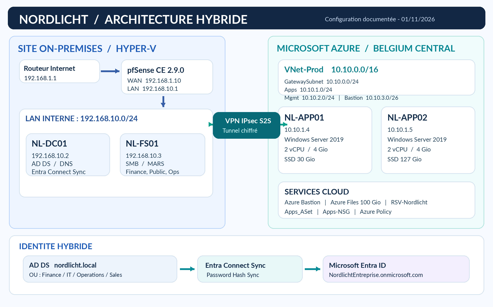

# Nordlicht — Hybrid IT Infrastructure Lab

## Project Overview

Nordlicht is a personal hands-on IT infrastructure project simulating a company's hybrid environment, combining on-premises Windows Server infrastructure with Microsoft Azure services.

The project was designed to develop practical skills in system administration, networking, cloud infrastructure, identity management, security, backup and troubleshooting.

## Technologies Used

- **Virtualization:** Microsoft Hyper-V
- **On-Premises:** Windows Server, Active Directory Domain Services, DNS, Group Policy, SMB File Server
- **Networking:** pfSense, IPsec/IKEv2 Site-to-Site VPN, routing and firewall rules
- **Microsoft Azure:** Virtual Machines, Virtual Network, VPN Gateway, Azure Bastion, Azure Files, Azure Backup
- **Identity:** Microsoft Entra ID, Entra Connect Sync, Password Hash Synchronization
- **Security & Governance:** Network Security Groups, Azure RBAC, Azure Policy
- **Tools:** PowerShell, Robocopy, Azure Portal

## Infrastructure Architecture

The environment consists of an on-premises Active Directory domain hosted on Hyper-V, connected to an Azure Virtual Network through a Site-to-Site IPsec VPN.

The architecture includes domain services, file services, Azure application servers, cloud storage, backup and hybrid identity synchronization.

## Technical Highlights

- Deployed Windows Server infrastructure with organizational units, security groups and Group Policy Objects.
- Established a Site-to-Site VPN between pfSense and Azure VPN Gateway.
- Validated connectivity between Azure virtual machines and on-premises file services.
- Configured Azure virtual machines, availability, networking and remote administration through Azure Bastion.
- Configured Azure Files and tested file migration using Robocopy.
- Implemented Azure VM Backup and Microsoft Azure Recovery Services Agent.
- Synchronized on-premises Active Directory identities to Microsoft Entra ID.

## Troubleshooting Experience

The project involved troubleshooting IPsec negotiation failures, firewall connectivity issues, Azure configuration challenges and identity synchronization problems.

These incidents were investigated and documented separately, including diagnostic steps and technical resolutions.

## Documentation

Technical reports, architecture diagrams and selected configuration screenshots will be added to this repository.

## Project Type

Personal learning laboratory simulating a business hybrid IT infrastructure. This is not a production deployment.

## Technical Documentation

- [Technical Infrastructure Report](docs/Nordlicht_Rapport_Technique_Censored.pdf)
- [Troubleshooting Journal](docs/Nordlicht_Troubleshooting_Censored.pdf)
